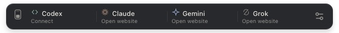
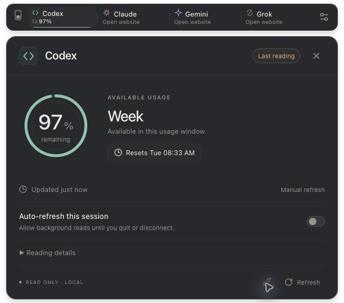
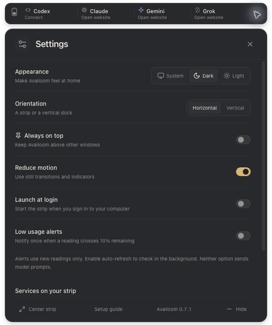
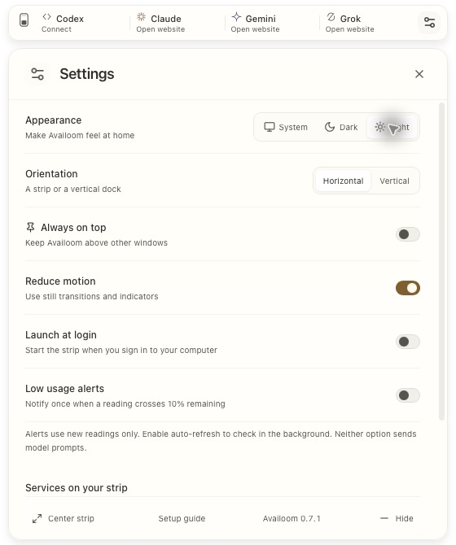
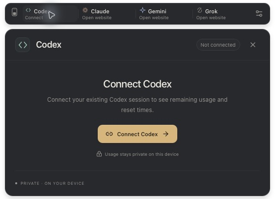

<p align="center">
  
</p>

<h1 align="center">Availoom</h1>
<p align="center"><strong>Your AI limits, at a glance.</strong></p>
<p align="center">A quiet desktop strip for checking your remaining AI subscription usage.</p>



Availoom keeps usage close to your work in a small floating strip. Open a service for details, check the limits returned by your account, and get back to what you were doing.

**Current release: 0.7.1 · macOS Apple Silicon pre-release.** Codex usage readings have been verified on a local account. Windows and Linux are development targets; native support has not been verified. macOS builds are currently unsigned and not notarized.

## What works today

- **Codex usage readings** from your existing, signed-in Codex CLI installation.
- **Actual quota windows**, including five-hour and weekly windows when returned by the provider. Unknown values stay unknown; additional pools are available in details.
- **One-click refresh** after connecting, with account checks before and after each reading.
- **Optional five-minute auto-refresh** for the current session, with offline waiting, cancellation and stale-reading indicators.
- **A thin horizontal strip or vertical dock**, with a choice of visible services.
- **Light, dark and system appearance**, reduced motion, keyboard navigation and an always-on-top option.
- **Menu-bar access**, saved window position, optional launch at login and low-usage notifications.

Launch at login and notifications are off by default. A notification is sent only when a new reading crosses from above 10% to 10% remaining or lower. Notifications require OS permission and new readings; they do not enable auto-refresh.

## Supported services

| Service | Usage integration in 0.7.1 |
| --- | --- |
| **Codex** | Experimental read-only adapter using the installed Codex CLI’s App Server. Shows account quota windows and reset times returned by the source. |
| **Claude** | Opens the provider website. Optional local CLI diagnostic distinguishes Claude sessions from external-provider configurations; it does not retrieve quotas. |
| **Gemini** | Opens the provider website. No automated usage adapter yet. |
| **Grok** | Opens the provider website. No automated usage adapter yet. |

Availoom does not estimate subscription quotas from token counts, combine unrelated plans, or assume every provider has a five-hour limit. It starts without usage numbers and contains no demo mode.

## A closer look

Real screenshots of the macOS application. Account identity is hidden. The connected view below uses a live Codex reading, not a test fixture. “Connect” and “Open website” describe services that are not connected.


### Connected to Codex



Captured on October 20, 2026 after connecting an existing signed-in Codex CLI session. This account returned **one weekly quota pool with 97% remaining**. The panel shows the remaining allowance, the source’s usage window and reset time, the age of the reading, and whether refresh is manual or automatic. **Reading details** stays collapsed to keep account identity out of the main view.

These are a snapshot of one account, not default values or a promised allowance. If a source returns five-hour and weekly pools, both appear; an absent pool is never invented. **Refresh** performs another guarded read without repeating the connection dialog. **Auto-refresh this session** is a separate opt-in; it is off in this screenshot.

### Appearance and connection

<table>
  <tr>
    <td width="50%"></td>
    <td width="50%"></td>
  </tr>
  <tr><td align="center">Warm graphite</td><td align="center">Ivory light</td></tr>
</table>



## Try it on macOS

For this pre-release, the verified platform is **Apple Silicon macOS**. An existing Codex CLI installation signed in to the account you want to inspect is required for quota readings. Availoom does not provide a login flow.

If you have a release ZIP, extract `Availoom.app`, move it to `/Applications`, then open it. Install it at its permanent location before enabling **Launch at login**. This repository also supports building from source below. A macOS Apple Silicon build is provided with the [0.7.1 pre-release](https://github.com/p4pryk/availoom/releases/tag/v0.7.1). The repository and pre-release downloads are public.

1. Open **Codex → Connect Codex**.
2. Review the detected executable and reading scope.
3. Choose **Connect for this session** to request a usage reading.
4. Use **Refresh** for another reading, or explicitly enable **Auto-refresh this session**.
5. Use **Disconnect** to clear the reading and end the connection.

Reading permission and quota data live in memory. Restarting the app requires connecting again. Auto-refresh stops on any reading error or account change. A session renewal can interrupt a read; the previous result stays marked stale, and a manual refresh can retry.

Drag the gauge mark to move the strip. Use the menu-bar icon to restore a hidden window. **Settings → Center strip** brings it back to the center of the screen.

| Shortcut | Action |
| --- | --- |
| `⌘ ,` on macOS / `Ctrl ,` elsewhere | Open settings |
| `Escape` | Close details and return focus |
| Arrow keys while a service is focused | Navigate services |
| `Home` / `End` | Jump to the first / last service |
| Arrow keys while the gauge mark is focused | Move the strip |
| `Enter` while the gauge mark is focused | Center the strip |

## Privacy

Availoom has no central backend, telemetry or account synchronization. The interface loads no remote fonts or images. Preferences and window position are stored locally; quota readings and account identity are not cached to disk by Availoom.

The Codex adapter launches your installed CLI, reads account metadata and rate limits, and rechecks the account. It sends no model prompt and requests no login, logout or credit redemption. The CLI uses its own session and may refresh credentials or write its own logs. The optional Claude diagnostic reads local configuration and authentication status, returning only installation/session status and an external provider hostname.

See [Privacy and data flow](docs/PRIVACY.md) for details.

## Build from source

Use **Node.js 22.12 or newer**, npm, Rust stable and the [Tauri platform prerequisites](https://v2.tauri.app/start/prerequisites/). On macOS, install the Xcode command-line tools as part of those prerequisites.

From the repository root:

```sh
npm ci
npm run tauri dev
```

Build the macOS application:

```sh
npm run tauri build -- --bundles app
```

Output: `src-tauri/target/release/bundle/macos/Availoom.app`.

The shared Rust backend and React interface use Tauri 2. The bundled identifier remains `local.orbit.ai-strip` to preserve settings from earlier Orbit builds. The release workflow is not an automatic updater.

## Validation and release scope

```sh
npm run build
npm test
npm run test:e2e
cargo test --manifest-path src-tauri/Cargo.toml --locked
cargo clippy --manifest-path src-tauri/Cargo.toml --locked --all-targets -- -D warnings
```

Local UI tests use Google Chrome. CI uses Chromium; install it with `npx playwright install --with-deps chromium` when running in a CI environment. Test fixtures stay in the test suite and never ship as a usage source.

The current suite has **15 frontend/domain tests, 22 Rust tests and 35 UI tests**, including dark/light accessibility scans, quota layout, consent, cancellation, stale data, offline recovery and account-change handling. Native checks cover launching, preferences and the rendered macOS interface. Live Codex reading was verified on one local account with CLI 0.163.0 on October 18, 2026; this does not establish compatibility with every account or CLI version.

Before a stable 1.0, remaining work includes Apple signing/notarization, a release/update channel, broader Codex compatibility, physical sleep/wake and multi-monitor checks, VoiceOver/text scaling, long-running usage tests, and actual OS notification/login-launch verification. A [GitHub Actions workflow template](docs/ci/github-actions.yml) is included for macOS, Windows and Linux. It is not active: the current GitHub connection cannot publish workflow files. See [CI setup](docs/ci/README.md) to enable it. No GitHub-hosted test results are claimed.

See [0.7.1 release notes](docs/RELEASE-0.7.1.md), [development details](docs/DEVELOPMENT.md) and [contribution guidance](CONTRIBUTING.md).

## License and affiliation

A source license has not been selected yet. No open-source license grant is included in this repository at this stage. Third-party dependencies retain their own licenses.

Availoom is an independent project and is not affiliated with OpenAI, Anthropic, Google or xAI. Provider names identify the services shown in the application.
